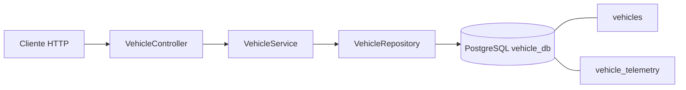
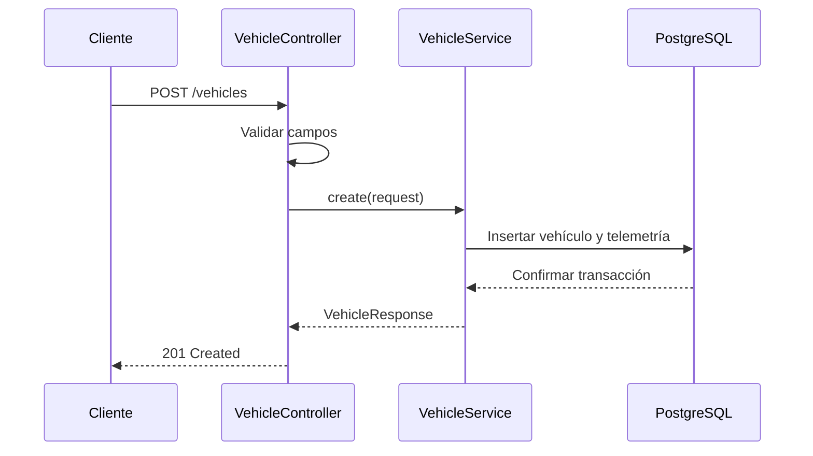

# Arquitectura de vehicle-service

## Componentes

## Alta de vehículo

`vehicles` guarda atributos estables. `vehicle_telemetry` guarda el estado actual, con una relación uno a uno. La entidad declara la placa como única en el esquema JPA.
